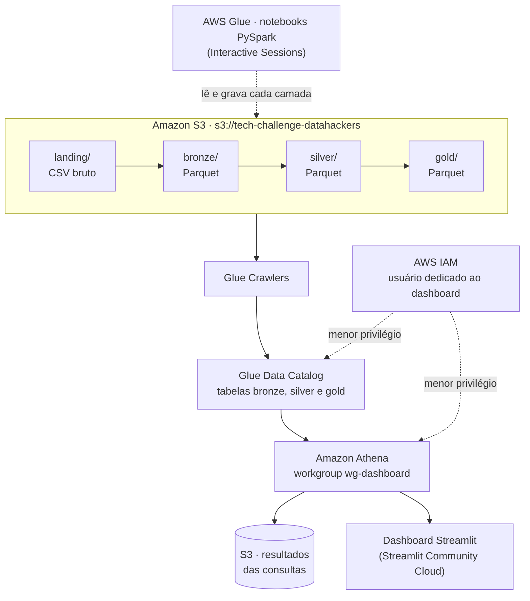
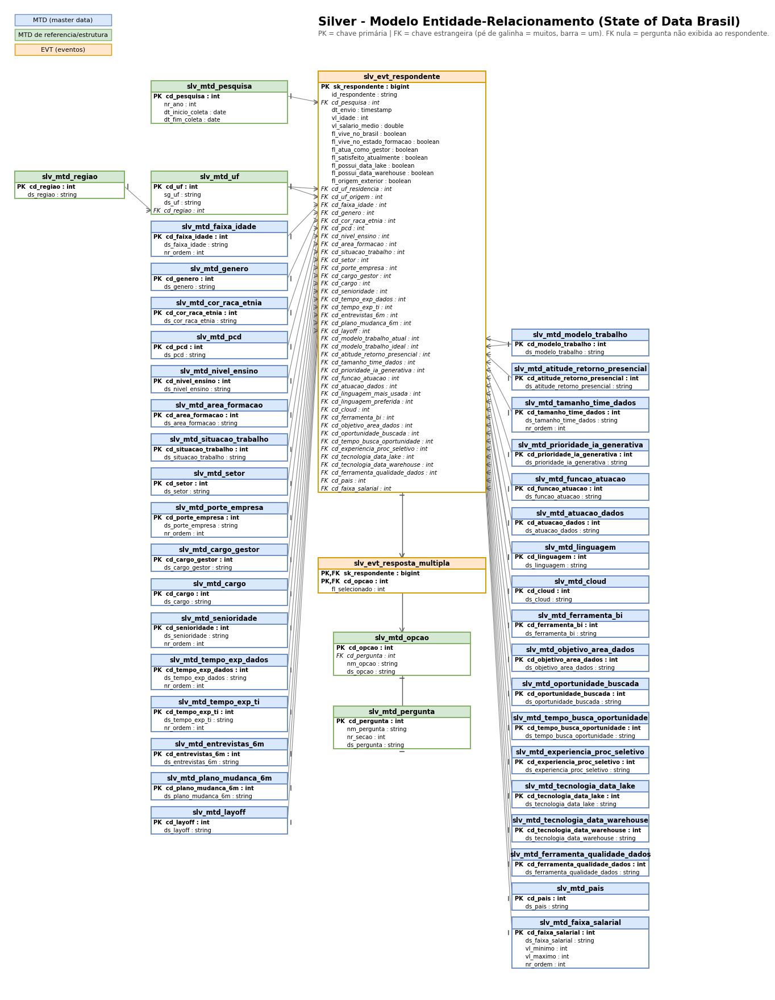
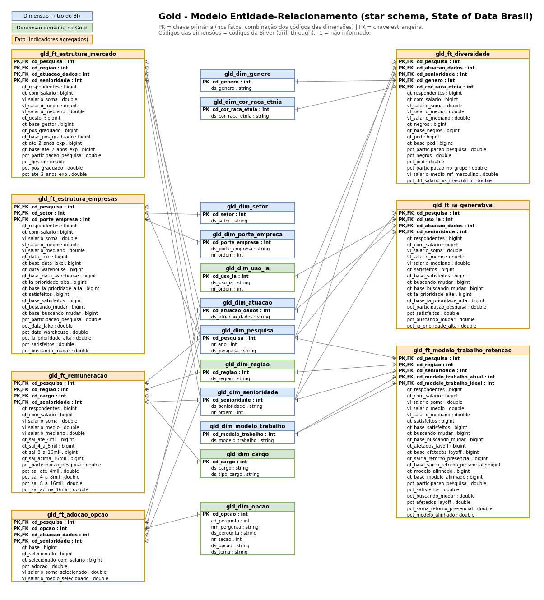

# Tech Challenge · Fase 3 — Data lake State of Data Brasil na AWS

Pipeline de dados ponta a ponta sobre a pesquisa **State of Data Brasil** (Data Hackers), edições **2024** e **2025**:
os CSVs originais entram num data lake no Amazon S3, são tratados em camadas por ETLs PySpark no AWS Glue,
catalogados no Glue Data Catalog, consultados pelo Amazon Athena e apresentados num dashboard Streamlit.

O objetivo analítico é responder sete perguntas de negócio sobre o mercado de dados no Brasil:

| # | Pergunta | Onde é respondida |
|---|---|---|
| 1 | Como está estruturado o mercado de dados (profissionais e empresas)? | `gld_ft_estrutura_mercado`, `gld_ft_estrutura_empresas` |
| 2 | Quais perfis são mais valorizados e quais as diferenças por região e senioridade? | `gld_ft_remuneracao` |
| 3 | Qual o cenário de diversidade (gênero, cor/raça, PcD)? | `gld_ft_diversidade` |
| 4 | Quais tecnologias têm maior adoção? | `gld_ft_adocao_opcao` |
| 5 | Como está a adoção de IA generativa e qual o seu impacto? | `gld_ft_ia_generativa` |
| 6 | Que diferenças o modelo de trabalho traz? | `gld_ft_modelo_trabalho_retencao` |
| 7 | Quais as oportunidades e os desafios das empresas para reter talentos? | `gld_ft_modelo_trabalho_retencao`, `gld_ft_adocao_opcao` |

---

## Sumário

1. [Arquitetura](#1-arquitetura)
2. [Estrutura do repositório](#2-estrutura-do-repositório)
3. [Data lake no S3](#3-data-lake-no-s3)
4. [ETL no AWS Glue](#4-etl-no-aws-glue)
5. [Glue Data Catalog](#5-glue-data-catalog)
6. [Amazon Athena](#6-amazon-athena)
7. [Segurança e IAM](#7-segurança-e-iam)
8. [Camada de visualização (Streamlit)](#8-camada-de-visualização-streamlit)
9. [Como reproduzir](#9-como-reproduzir)
10. [Decisões de projeto](#10-decisões-de-projeto)
11. [Limitações e cuidados na leitura](#11-limitações-e-cuidados-na-leitura)

---

## 1. Arquitetura



| Componente | Serviço | Papel |
|---|---|---|
| Armazenamento | **Amazon S3** | Um bucket com um prefixo por camada: `landing/` (CSV), `bronze/`, `silver/` e `gold/` (Parquet). |
| Processamento | **AWS Glue** (Interactive Sessions, PySpark) | Três notebooks, um por transição de camada: tratamento, modelagem e validação. |
| Metadados | **Glue Data Catalog** + Crawlers | Registra o schema e a localização de cada tabela Parquet para consulta via SQL. |
| Consulta | **Amazon Athena** | SQL serverless sobre o catálogo, no workgroup `wg-dashboard`, com configuração imposta e limite de dados escaneados. |
| Acesso | **AWS IAM** | Usuário exclusivo do dashboard, que só enxerga a camada gold. |
| Visualização | **Streamlit** | Dashboard multipágina que consome apenas a gold, hospedado no Streamlit Community Cloud. |

### Papel de cada camada

| Camada | Formato | Granularidade | Modelagem | Para quem |
|---|---|---|---|---|
| **Landing** | CSV, como recebido | 1 linha por resposta do formulário | nenhuma (origem bruta) | arquivamento e reprocessamento |
| **Bronze** | Parquet particionado por ano | 1 linha por respondente + formato longo para múltipla escolha | nomes padronizados entre anos, tipos corrigidos | engenharia |
| **Silver** | Parquet | **analítica, alta granularidade** (respondente e resposta) | **normalizada** (master data + eventos, PK/FK validadas) | análise exploratória e *drill-through* |
| **Gold** | Parquet | **sintética, agregada, baixa granularidade** | **star schema** (dimensões + um fato por tema) | BI / dashboard |

---

## 2. Estrutura do repositório

```
fase_3/
├── landing/                                   # CSVs originais da pesquisa (2024 e 2025)
├── bronze/
│   └── ETL_ingestion_bronze_layer.ipynb       # landing -> bronze
├── silver/
│   ├── ETL_ingestion_silver_layer.ipynb       # bronze -> silver (modelo normalizado)
│   └── doc/                                   # diagrama ER da silver (.drawio e .png)
├── gold/
│   ├── gold_star_schema_state_of_data.ipynb   # silver -> gold (star schema)
│   └── doc/                                   # diagrama ER da gold (.drawio e .png)
└── app/                                       # dashboard Streamlit (ver app/README.md)
    ├── app.py
    ├── core/                                  # acesso a dados, métricas, gráficos e filtros
    ├── paginas/                               # uma página por pergunta de negócio
    ├── especificacao_dash.md                  # perguntas de negócio x fatos x dimensões
    └── requirements.txt
```

---

## 3. Data lake no S3

Bucket: **`s3://tech-challenge-datahackers`**, região `us-east-1`.

| Prefixo | Conteúdo | Organização |
|---|---|---|
| `landing/{ano}/` | CSV original de cada edição | uma pasta por ano (`landing/2024/`, `landing/2025/`) |
| `bronze/<tabela>/` | `respondentes`, `respostas_multipla`, `dim_perguntas` | Parquet particionado por `ano_pesquisa=AAAA` |
| `silver/<tabela>/` | 40 tabelas `slv_mtd_*`, 2 `slv_evt_*` e `slv_meta_constraints` | Parquet, uma pasta por tabela |
| `gold/<tabela>/` | 12 `gld_dim_*`, 7 `gld_ft_*` e `gld_meta_constraints` | Parquet, uma pasta por tabela (1 arquivo cada) |

**Por que Parquet:** formato colunar e comprimido. O Athena lê só as colunas da consulta e cobra pelo volume escaneado.
A gold inteira ocupa **221 KB**, e o `SELECT *` no maior fato escaneia **80 KB**.

### Volumes por camada

| Camada | Tabela | Linhas |
|---|---|---|
| Landing | CSV 2024 · CSV 2025 | 5.217 (403 colunas) · 3.495 (388 colunas) |
| Bronze | `respondentes` | 8.709 (5.215 em 2024 + 3.494 em 2025, após remover tokens duplicados) |
| Bronze | `respostas_multipla` | 1.026.336 |
| Silver | `slv_evt_respondente` · `slv_evt_resposta_multipla` | 8.709 · 1.026.336 |
| Gold | 7 fatos | de 140 (`gld_ft_ia_generativa`) a 4.512 (`gld_ft_adocao_opcao`) |
| Gold | 12 dimensões | de 2 (`gld_dim_pesquisa`) a 325 (`gld_dim_opcao`) |

---

## 4. ETL no AWS Glue

As três ETLs são notebooks PySpark executados no **AWS Glue Interactive Sessions** (kernel *Glue PySpark*), com a mesma
configuração de sessão:

```
%idle_timeout 30        # encerra a sessão após 30 min ociosa (controle de custo)
%worker_type G.1X
%number_of_workers 2    # a base é pequena: 2 workers bastam
```

Cada notebook termina com uma **etapa de validação** que interrompe a execução (`assert`) se os dados não estiverem consistentes.

### 4.1 Landing → Bronze · [`bronze/ETL_ingestion_bronze_layer.ipynb`](bronze/ETL_ingestion_bronze_layer.ipynb)

Objetivo: deixar os dois anos **com o mesmo schema** e tipos corretos, sem ainda modelar.

| Problema na origem | Tratamento |
|---|---|
| Colunas nomeadas com o código da pergunta, que **muda entre os anos** (ex.: banco de dados é `4.g` em 2024 e `4.d` em 2025) | O nome vira o *slug* do rótulo, sem o código (`slug("4.d_Banco de dados")` → `banco_de_dados`). |
| Perguntas renomeadas entre os anos | `ALIAS_PERGUNTA` unifica (ex.: `s4_linguagem_preferida` → `s4_linguagem_de_programacao_dia_a_dia`). |
| Múltipla escolha em centenas de colunas 0/1 | Viram o **formato longo** `respostas_multipla(id_respondente, pergunta, opcao, selecionado)`. A coluna-texto que repetia a lista é descartada. Coluna vazia = pergunta não exibida, e a linha não é gerada. |
| Respondentes duplicados | `dropDuplicates(["id_respondente"])`. |
| Erros de digitação em 2025 (`R$ 3000/mês`, `de 501 a 100`) | Dicionário `CORRECOES`. |
| Tipos inconsistentes | Data/hora → `timestamp`; sim/não → `boolean`; idade → `int`; demais textos → `string` (evita conflito de tipo entre anos). |
| Salário informado em faixa de texto | Extração de `salario_min`, `salario_max` e `salario_medio` (ponto médio da faixa). |

Saídas, particionadas por `ano_pesquisa` com `partitionOverwriteMode=dynamic` (reprocessar um ano substitui só a partição
dele):

| Tabela | Conteúdo |
|---|---|
| `respondentes` | 1 linha por respondente, campos de perfil e trabalho com nomes iguais em todos os anos |
| `respostas_multipla` | formato longo das perguntas de múltipla escolha |
| `dim_perguntas` | dicionário de linhagem: coluna original do CSV → coluna na bronze, com o rótulo original |

### 4.2 Bronze → Silver · [`silver/ETL_ingestion_silver_layer.ipynb`](silver/ETL_ingestion_silver_layer.ipynb)

Objetivo: um **modelo relacional normalizado** no grão do respondente, com domínios padronizados e integridade garantida.
O processamento é *full refresh* (a base é pequena): códigos e eventos são recriados juntos, sem risco de inconsistência.

| Prefixo | Tipo | Conteúdo |
|---|---|---|
| `slv_mtd_*` (40 tabelas) | Master data | um código `cd_` para cada valor do domínio (gênero, senioridade, faixa salarial, UF, opção de múltipla escolha...). Domínios ordinais têm `nr_ordem`. |
| `slv_evt_respondente` | Evento | 1 linha por respondente: só códigos (FK), flags `fl_*` e medidas `vl_*` |
| `slv_evt_resposta_multipla` | Evento | 1 linha por (respondente, opção), com `fl_selecionado` |
| `slv_meta_constraints` | Metadados | PKs e FKs do modelo |

Principais regras:

- **Padronização de domínio (`canonizar`):** unifica grafias da mesma resposta (espaços, barras, maiúsculas, acentos, ex.
  `Italia`/`Itália`) e aplica `ALIAS_VALORES` (ex.: `Apache Superset` → `Superset`). Em respostas livres, valores com
  frequência abaixo de um mínimo viram `Outros (resposta livre)`.
- **Domínios compartilhados:** modelo de trabalho atual e ideal usam a mesma MTD, com duas FKs.
- **Tabelas de referência:** UF e região com códigos do IBGE. A UF é derivada da sigla ou do texto do estado.
- **Chave substituta estável:** `sk_respondente = xxhash64(ano, id_respondente)`, que não muda entre execuções.
- **FK nula permitida:** significa "pergunta não exibida ao respondente", diferente de "respondeu não".
- **Validação:** como o Parquet não impõe constraints, o notebook verifica cada PK (sem nulos e sem duplicidade) e cada FK
  (sem órfãos) registrada em `slv_meta_constraints`.



### 4.3 Silver → Gold · [`gold/gold_star_schema_state_of_data.ipynb`](gold/gold_star_schema_state_of_data.ipynb)

Objetivo: um **star schema agregado**, pronto para o BI. Cada dimensão é um filtro; cada fato responde a um tema, já
agrupado pelos códigos das dimensões e com os indicadores calculados.

**Dimensões (`gld_dim_*`, 12 tabelas)**

- Copiam a MTD da silver **mantendo os códigos**, o que permite *drill-through*: o detalhe de qualquer número da gold é
  encontrado filtrando `slv_evt_respondente` pelos mesmos códigos.
- Recebem o membro **`-1 = "Não informado"`**: na gold nenhuma FK é nula, assim um filtro do BI não perde linhas.
- **Dimensões derivadas** (verdes no diagrama):

| Dimensão | Como é derivada |
|---|---|
| `gld_dim_regiao` | região da UF de residência, mais o membro `-2 = "Exterior"` |
| `gld_dim_cargo` | cargos individuais (código da silver) + cargos de gestão (código + 100, prefixo "Gestão:") |
| `gld_dim_uso_ia` | nova categoria ordinal de uso de IA generativa: não usa → gratuita → Copilot → paga do próprio bolso → empresa paga |
| `gld_dim_opcao` | opções de múltipla escolha com um **tema** para filtrar (linguagens, cloud, BI, barreiras de IA, motivos de insatisfação...) |

**Fatos (`gld_ft_*`, 7 tabelas)**

| Fato | Grão (PK = combinação das dimensões) | Indicadores |
|---|---|---|
| `gld_ft_estrutura_mercado` | pesquisa × região × atuação × senioridade | respondentes, salário, % gestores, % pós-graduados, % até 2 anos de experiência |
| `gld_ft_estrutura_empresas` | pesquisa × setor × porte | % data lake, % data warehouse, % IA prioridade alta, % satisfeitos, % buscando mudar |
| `gld_ft_remuneracao` | pesquisa × região × cargo × senioridade | salário (soma, média, mediana) e 4 faixas: até R$ 4 mil, 4–8 mil, 8–16 mil, acima de 16 mil |
| `gld_ft_diversidade` | pesquisa × gênero × cor/raça × atuação × senioridade | % negros, % PcD, participação no grupo, diferença salarial vs. homens do mesmo grupo |
| `gld_ft_adocao_opcao` | pesquisa × opção × atuação × senioridade | % de adoção e salário médio de quem usa a opção |
| `gld_ft_ia_generativa` | pesquisa × uso de IA × atuação × senioridade | salário, % satisfeitos, % buscando mudar, % IA prioridade alta |
| `gld_ft_modelo_trabalho_retencao` | pesquisa × região × senioridade × modelo atual × modelo ideal | % satisfeitos, % buscando mudar, % afetados por layoff, % que sairia com retorno presencial, % modelo alinhado |

**Como os indicadores são calculados.** Uma base intermediária calcula, por respondente, `ind_<x>` (1 = atende ao
critério) e `bas_<x>` (1 = respondeu a pergunta). O fato soma as duas e gera:

- `qt_<x>` e `qt_base_<x>`: **aditivos**, podem ser somados sob qualquer filtro;
- `pct_<x> = qt_<x> / qt_base_<x>`: o denominador é **quem respondeu**, não o total. Só vale no grão do fato. Ao agregar
  além do grão, o consumidor recalcula `SUM(qt_x) / SUM(qt_base_x)`;
- `pct_participacao_pesquisa`: participação da linha no total do ano (soma 100% por ano).

**Validação:** 48 constraints (PK e FK) verificadas e gravadas em `gld_meta_constraints`, mais uma **reconciliação com a
silver**: o total de respondentes de cada fato, por ano, tem que bater com `slv_evt_respondente`, e o total de opções
selecionadas tem que bater com `slv_evt_resposta_multipla`.



---

## 5. Glue Data Catalog

As tabelas Parquet de cada camada são registradas no **Glue Data Catalog** por **Glue Crawlers**, o que as torna
consultáveis em SQL pelo Athena sem mover dados.

| Camada | Conteúdo no catálogo | Natureza |
|---|---|---|
| Bronze | `respondentes`, `respostas_multipla`, `dim_perguntas` | dados padronizados, ainda próximos da origem |
| Silver | `slv_mtd_*`, `slv_evt_*`, `slv_meta_constraints` | **analítica**, alta granularidade (respondente / resposta) |
| Gold · database **`db_gold`** | `gld_dim_*`, `gld_ft_*`, `gld_meta_constraints` (20 tabelas) | **sintética**, agregada, baixa granularidade |

O `db_gold` ("Camada gold do datalake") é populado pelo crawler **`ETL_ingestion_db_gold`**, executado com a role de
serviço `AWSGlueServiceRole-EDE`. Cada tabela aponta para `s3://tech-challenge-datahackers/gold/<tabela>/`
(classificação `parquet`). O crawler deve ser executado novamente quando o schema de uma tabela mudar. Uma nova carga
com o mesmo schema é lida direto pelo Athena.

---

## 6. Amazon Athena

O consumo é feito por um workgroup dedicado, **`wg-dashboard`** ("Workgroup para consumo do dashboard"):

| Configuração | Valor | Por quê |
|---|---|---|
| Motor | Athena engine version 3 | versão atual do motor (Trino) |
| Local de resultados | `s3://techchallenge-athena-results-709444203959/results/` | bucket separado do data lake |
| Impor configuração do workgroup (`EnforceWorkGroupConfiguration`) | ativado | o cliente não consegue trocar o local de resultados nem burlar os limites |
| Limite de dados escaneados por consulta (`BytesScannedCutoffPerQuery`) | ver abaixo | teto de custo: a consulta é cancelada se passar do limite |
| Métricas no CloudWatch | ativadas | acompanhamento de volume escaneado e de execuções |

**Custo:** o Athena cobra por volume escaneado, com mínimo de 10 MB por consulta. Como a gold é Parquet e agregada, cada
consulta do dashboard escaneia poucos KB (80 KB no maior fato). Um limite de **10 MB por consulta** (o mínimo aceito pelo
Athena) já cobre com folga todas as consultas do dashboard e corta qualquer consulta acidental sobre volumes maiores.

Exemplo de consulta no star schema (salário médio por cargo em 2025):

```sql
SELECT c.ds_cargo,
       SUM(f.qt_com_salario)                                 AS respondentes,
       ROUND(SUM(f.vl_salario_soma) / SUM(f.qt_com_salario)) AS salario_medio
FROM   gld_ft_remuneracao f
JOIN   gld_dim_cargo    c ON c.cd_cargo    = f.cd_cargo
JOIN   gld_dim_pesquisa p ON p.cd_pesquisa = f.cd_pesquisa
WHERE  p.nr_ano = 2025
GROUP  BY c.ds_cargo
HAVING SUM(f.qt_com_salario) >= 30
ORDER  BY salario_medio DESC;
```

---

## 7. Segurança e IAM

O dashboard usa um usuário IAM próprio, **`user-streamlit-dashboard`**, com permissões mínimas: ele só enxerga a
camada gold. O quadro abaixo foi conferido com as próprias credenciais do usuário.

| Recurso | Permitido | Negado |
|---|---|---|
| Glue Data Catalog | ler o database `db_gold` e suas tabelas | outros databases; listar crawlers e jobs |
| S3 data lake | ler `gold/` | `landing/`, `bronze/`, `silver/` |
| Athena | executar consultas no `wg-dashboard` | listar os workgroups da conta |
| S3 resultados do Athena | ler e gravar no bucket de resultados | — |

Outras práticas:

- **Credenciais fora do código:** ficam em `app/.streamlit/secrets.toml` (no `.gitignore`) localmente e em
  *Settings → Secrets* no Streamlit Community Cloud.
- **Separação de papéis:** as ETLs e os crawlers rodam com a role de serviço do Glue. O dashboard só lê.
- **Bucket de resultados separado** do data lake, com caminho imposto pelo workgroup.

---

## 8. Camada de visualização (Streamlit)

Código em [`app/`](app/) (detalhes em [`app/README.md`](app/README.md)). O dashboard consome **apenas a camada gold**.

### Páginas

| Página | Fato | Filtros |
|---|---|---|
| Estrutura do mercado | `gld_ft_estrutura_mercado` | região, área de atuação, senioridade |
| Empresas e maturidade | `gld_ft_estrutura_empresas` | setor, porte |
| Remuneração | `gld_ft_remuneracao` | região, cargo, senioridade |
| Diversidade | `gld_ft_diversidade` | gênero, cor/raça, área de atuação, senioridade |
| Modelo de trabalho e retenção | `gld_ft_modelo_trabalho_retencao` (+ `gld_ft_adocao_opcao`) | região, senioridade, modelo atual, modelo ideal |
| Tecnologias | `gld_ft_adocao_opcao` | tema, opção, área de atuação, senioridade |
| IA generativa | `gld_ft_ia_generativa` (+ `gld_ft_adocao_opcao`) | uso de IA, área de atuação, senioridade |
| Sobre os dados | — | metodologia, conexão e recarga do cache |

A edição da pesquisa (2024, 2025 ou as duas) é um filtro global da barra lateral. Com as duas selecionadas, os cartões
mostram a variação entre os anos e os gráficos comparam as edições lado a lado.

### Como o app lê e calcula

- **Acesso a dados** ([`app/core/dados.py`](app/core/dados.py)): `SELECT *` de cada tabela da gold pelo Athena
  (`awswrangler`), com as 20 tabelas lidas em paralelo e guardadas em cache (`st.cache_data`) por 6 horas. Se o Athena
  estiver indisponível, o app lê o Parquet direto pelo catálogo Glue. A barra lateral mostra qual caminho está em uso.
- **Métricas** ([`app/core/metricas.py`](app/core/metricas.py)): todo percentual é recalculado como
  `SUM(qt_x) / SUM(qt_base_x)` e o salário médio como `SUM(vl_salario_soma) / SUM(qt_com_salario)`, seguindo a regra de
  aditividade da gold. Grupos com poucas respostas são omitidos dos rankings.
- **Visualização** ([`app/core/graficos.py`](app/core/graficos.py)): Plotly, com tema claro/escuro, cor fixa por ano e
  tabela de dados disponível em cada gráfico.

### Executar e publicar

```bash
cd fase_3/app
pip install -r requirements.txt
streamlit run app.py
```

Dashbord publicado: [`datahackers-dashbord`](https://tech-challenge-datahackers-dashbord.streamlit.app/)

---

## 9. Como reproduzir

1. **Landing:** envie os CSVs para `s3://tech-challenge-datahackers/landing/2024/` e `.../landing/2025/`.
2. **Bronze:** execute `bronze/ETL_ingestion_bronze_layer.ipynb` numa Glue Interactive Session. Confira a contagem de
   respondentes por ano na célula de validação.
3. **Silver:** execute `silver/ETL_ingestion_silver_layer.ipynb` do início ao fim. A célula de validação precisa terminar com
   "todas OK".
4. **Gold:** execute `gold/gold_star_schema_state_of_data.ipynb`. A validação de PK/FK e a reconciliação com a silver
   precisam passar.
5. **Catálogo:** rode os crawlers (para a gold, `ETL_ingestion_db_gold`) se alguma tabela for nova ou tiver mudado de schema.
6. **Consulta:** valide no Athena, no workgroup `wg-dashboard`, com a consulta de exemplo da seção 6.
7. **Dashboard:** rode o app localmente ou publique no Streamlit Community Cloud (seção 8). Depois de uma nova carga, use
   *Recarregar dados da gold* na página "Sobre os dados".

---

## 10. Decisões de projeto

| Decisão | Motivo |
|---|---|
| Arquitetura medalhão (landing → bronze → silver → gold) | separa preservação da origem, padronização, modelagem analítica e consumo. Cada camada pode ser reprocessada sem afetar a anterior. |
| Silver **normalizada** e gold em **star schema** | a silver guarda o detalhe íntegro e reutilizável; a gold é otimizada para leitura simples e rápida pelo BI. |
| Códigos da silver mantidos na gold | *drill-through*: qualquer número agregado pode ser rastreado até os respondentes. |
| Membro `-1 "Não informado"` nas dimensões | filtros do BI nunca descartam linhas silenciosamente. |
| Indicadores como pares `qt_x` / `qt_base_x` | percentuais corretos sob qualquer combinação de filtros, sem média de médias. |
| Constraints validadas no próprio notebook | o Parquet não impõe PK/FK; a carga falha antes de publicar dados inconsistentes. |
| Parquet + workgroup com configuração imposta | custo previsível no Athena: pouco volume escaneado e teto por consulta. |
| Usuário IAM exclusivo e só de leitura da gold | o app publicado na internet não tem acesso às camadas internas. |

---

## 11. Limitações e cuidados na leitura

- **Salário estimado:** a pesquisa informa faixas salariais. Os valores são médias dos pontos médios das faixas.
- **Comparação entre anos:** a amostra de 2024 só tem pessoas de 18 a 27 anos, enquanto a de 2025 vai até 71. Diferenças
  entre as edições refletem também essa mudança de público.
- **IA generativa:** a relação entre uso de IA e salário é uma **correlação**. Quem usa IA paga pela empresa tende a ser
  mais sênior; o dashboard compara dentro da mesma senioridade para separar parte desse efeito.
- **Linguagens:** em 2025 a pergunta teve opções removidas. SQL, Python e R comparam bem entre os anos, Java e JavaScript não.
- **Senioridade "Não informado":** é grande (277 respondentes em 2025) porque gestores e quem não está trabalhando não
  preenchem esse campo.
- **Percepção, não censo:** indicadores de empresa (data lake, prioridade de IA) vêm da resposta dos profissionais; uma
  empresa com muitos respondentes pesa mais.
